# Lab Desktop

Criado por Thiago Bezerra. Licença MIT.

## A ideia

**O problema.** Quem cuida de servidores e de projetos (uma VPS, um servidor em casa, uma instância na AWS) acaba decorando comandos: `ssh` com a chave certa, `docker compose`, `scp`, onde fica cada pasta, como abrir um túnel. É fácil errar, é fácil deixar uma chave solta e é difícil ver, de relance, se o servidor está bem.

**A ideia.** Um aplicativo de computador (Mac, Windows e Linux), em Java 21, que junta tudo isso numa janela só, com cuidado de segurança em cada passo: você cadastra o servidor, o app guarda as chaves num cofre cifrado e mostra o que está acontecendo, sem você decorar nada.

**Para quem é.** Para quem mantém servidores com Docker e projetos pequenos ou médios (uma pessoa ou um time pequeno) e quer um painel claro, em vez de uma pilha de terminais.

**O que o app NUNCA faz.**

- Não instala nada sem o seu clique: cada instalação mostra o que vai fazer, comando por comando, e só acontece depois da sua confirmação.
- Não guarda a senha do servidor: se você a digita para instalar a chave, ela fica só na memória, vai direto ao servidor e é descartada.
- Não envia dados para a internet por conta própria: ele só fala com os servidores que você cadastra e, se você pedir, com a sua conta da Cloudflare.
- Não instala inteligência artificial.
- Não faz push para o GitHub, não liga o projeto a um repositório remoto e não mescla nem desfaz commits (o Git do projeto lê e cria repositório local; nada além disso).

## Como instalar

Baixe o instalador do seu sistema (`docs/INSTALAR.md`, escrito para quem não é técnico) ou rode `./gradlew run` (veja "Desenvolvimento"). Na primeira abertura o app pede para criar a senha-mestra do cofre; ela não tem recuperação, então guarde-a bem. Depois escolha "Adicionar servidor", informe como conectar (direto por SSH, AWS ou Cloudflare), confira a impressão digital e, se quiser, deixe o app instalar a chave e o agente depois de mostrar o que vai fazer. Quem não tem servidor pode usar "Este computador": o laboratório roda no Docker local.

## O que o app faz

| O que | Como funciona | Estado |
|---|---|---|
| **Cofre de chaves SSH** | Cifrado por uma senha-mestra (Argon2id e AES-256-GCM); as chaves e os tokens nunca saem do computador. | Pronto. |
| **Vários servidores** | SSH pelo Apache MINA SSHD, impressão digital conferida na primeira conexão, reconexão sozinha. Se o servidor não volta (12 falhas seguidas), o app passa a tentar a cada 5 minutos e a faixa diz desde quando e por quê; uma mudança de rede adianta a próxima tentativa. | Pronto. Testado com um servidor SSH embutido nos testes; falta prova num servidor real. |
| **Primeira conexão com senha e chave recusada** | A senha vale uma vez: o app instala a chave, prova que ela entra e passa a usar só a chave. "Chave recusada" tem o botão "Instalar a chave com a senha…". Desligar o login por senha é opcional e nunca é automático. | Pronto. |
| **Resumo do servidor** | Saúde, CPU, memória, disco, containers, seis gráficos de tendência (10 min a 1 mês), relatório (mínimo, média, máximo, P95, pico), registro do servidor (só leitura) e o que pede atenção. | Pronto; precisa do agente de monitoramento. |
| **Segurança, Containers, Processos e Máquina** | Tentativas de entrada, logins, firewall, SSH e bloqueio; containers; os processos que mais gastam; hardware, versões e disco. Em Processos, "Encerrar" (SIGTERM, depois "Forçar" por outro clique) e Parar e Reiniciar para containers. | Pronto. |
| **Projetos** | Lista e página de cada projeto: Visão geral, Logs, Terminal, Arquivos, Git, Backups (baixar), Consumo e limite (só com Claude), Internet e Processos. Iniciar, parar e reiniciar. | Pronto. |
| **Novo projeto** | Criar do zero, importar (por Git, de uma pasta do seu computador ou de uma pasta do servidor) e adicionar um container (Node, Postgres, Redis ou imagem), com a diferença do `docker-compose.yml` à vista antes de gravar. | Pronto. |
| **Git do projeto** | Linha "Código" na Visão geral e aba Git: commits, o que cada um mudou (diff), alterações não commitadas e branches, só leitura. Acha o repositório que mora numa subpasta (`app/`) e deixa você escolher entre vários. Cria o repositório local (primeiro commit, `.gitignore` com segredos de fora, identidade só no repositório) e instala o Git no servidor, depois de mostrar os comandos. | Pronto (ler e criar). **Não existe:** aprovar e mesclar, desfazer, push e remoto. |
| **Cloudflare** | Conectar a conta com um token (que fica só no cofre), ver conta, domínio e túnel, Adicionar domínio, Publicar na internet e Remover um endereço, com a prévia de tudo o que muda; túnel gerido por arquivo no servidor ou pela API. | Pronto; falta prova contra a Cloudflare real. |
| **Conexão sem porta aberta** | O app sobe sozinho o `aws ssm start-session` ou o `cloudflared access tcp` numa porta aleatória de 127.0.0.1 e o SSH conecta por dentro; o programa encerra junto com a conexão. | Pronto; testado com programas de mentira e um processo de verdade; falta prova contra a AWS e a Cloudflare reais. |
| **Servidor protegido** | Uma marca que faz o app só ler e conectar: ele não instala, atualiza nem remove nada, nem muda chaves ou a senha de acesso. | Pronto. |
| **Agente de monitoramento** | Instalar ("O que instalar": completo, escolher ou só SSH), atualizar e remover, sempre depois do seu clique. | Pronto; o pacote do agente não vem neste repositório. |
| **Este computador** | O laboratório no próprio computador, no Docker, sem SSH. "Preparar este computador" confere o que falta e só instala depois da confirmação. | Pronto; provado no Mac com o Docker de verdade; no Windows e no Linux falta prova. |
| **Arquivos e Terminal** | Gerenciador por SFTP (abrir, editar com cópia de segurança, enviar, baixar, apagar, mover) e terminal nativo com PTY, no servidor e em cada projeto. Ao sair de um projeto com terminal aberto o app pergunta, e a caixa "Não perguntar de novo" (desfeita em Ajustes > Terminal) silencia a pergunta. | Pronto. |
| **Ajustes, Sobre e Ajuda** | Tema, tamanho do texto, ordem das abas, terminal, containers protegidos, versão e licenças, e uma Ajuda em categorias (F1). | Pronto. |
| **Claude opcional** | Se o servidor tiver o Claude, o app mostra as sessões, o consumo e o limite; sem ele, tudo o mais funciona igual. | Pronto. |

**O que ainda não existe:** trocar a chave ou o token de um servidor e "redefinir pin"; a segunda parte do Git (aprovar, mesclar, desfazer, publicar); notificações do sistema e ícone na barra de menus; a tela de consumo da conta inteira; retomar um download interrompido; assinatura de código paga nos instaladores.

## Configurações

O que você pode mudar no app, onde fica e o que ele **não** faz sozinho. Tudo o que escreve num servidor mostra antes o que vai fazer e só age depois do seu clique.

| Configuração | Onde fica | O que muda | O que NÃO faz sozinho |
|---|---|---|---|
| Tema e tamanho do texto | Ajustes > Aparência | Claro, escuro ou o do sistema; texto a 100, 115 ou 130 %. | Nada além da aparência. |
| Ordem e abas escondidas | Ajustes > Navegação | A ordem e quais abas aparecem no servidor e no projeto; os atalhos numerados seguem a ordem. | Não esconde a aba que está aberta nem deixa a barra vazia. |
| Terminal | Ajustes > Terminal | As preferências do terminal: tamanho da letra, Option como Meta, copiar ao selecionar. | — |
| Perguntar ao sair de um projeto | Ajustes > Terminal, grupo "Ao sair de um projeto"; a caixa "Não perguntar de novo" da própria pergunta | Sair da página de um projeto com terminal aberto fecha o terminal, então o app pergunta. Marcar "Não perguntar de novo" e confirmar desliga a pergunta; a caixa de Ajustes volta a ligá-la. Sem a pergunta, o app sai direto e avisa que o terminal foi fechado. | Cancelar ignora a marca. Só essa pergunta tem a caixa: apagar, remover servidor, instalar e as outras ações que mexem no servidor continuam sempre perguntando. |
| Containers protegidos | Ajustes > Segurança; "Proteger este container" na janela de Parar | A lista dos containers que o app não para nem reinicia. | Não libera um container sozinho (é aqui que você libera). Os de túnel e de proxy (`cloudflared`, `traefik`, `caddy`...) já vêm protegidos. |
| Como conectar | Adicionar ou Editar servidor | Direto (endereço e porta), AWS Session Manager (instância, região, perfil e porta do SSH) ou Cloudflare (endereço do túnel). | Não instala o `aws`, o plugin do Session Manager nem o `cloudflared`; não faz login na AWS (`aws sso login`) nem na Cloudflare. "Conferir as ferramentas neste computador" só mostra o que falta, como texto. |
| Servidor protegido | Adicionar ou Editar servidor | O app só lê e conecta: recusa instalar, atualizar e remover o agente, o Docker e o Git. | Não desmarca sozinho. Pode marcar sozinho, com um aviso, um servidor onde vê o agente instalado por fora. |
| Primeira conexão com senha | Adicionar servidor, passo 2 | Instala a chave pública no servidor e prova que ela entra. | Não guarda a senha; aceita no máximo 4 tentativas em 10 minutos; só envia a senha se a impressão digital for a que você confirmou. |
| Instalar a chave com a senha | Cartão do servidor, aviso "Chave recusada", Servidor, Editar | Conserta um servidor que recusa a chave do app. | Não pergunta nem desliga o login por senha; para se a impressão digital mudou. |
| Desligar o login por senha | Segurança > SSH e bloqueio, ou no fim do assistente | Cria uma regra do SSH no servidor, depois de mostrar o que faz e os riscos. Faz cópia datada, confere a configuração, recarrega o SSH e desfaz sozinho se a chave não entrar. | Nunca é automático: você marca que tem outro jeito de entrar e digita o nome do servidor. Não liga a senha de volta (mostra o comando). Sem permissão, só mostra o comando. |
| Código do autenticador (2FA) | Menu Servidor > Configurar 2FA | Liga ou desliga o código de 6 dígitos do agente; este computador fica liberado por 30 dias. | Não liga sem você confirmar um código. |
| Instalar o agente | Faixa do servidor, menu Servidor, "O que instalar" | Completo, escolher os itens ou só SSH. | Não instala sem o clique, não pede senha de administrador, não abre porta no firewall e não instala metade. |
| Encerrar e reiniciar processos | Servidor > Processos, e a aba Processos do projeto | Pede ao programa para fechar (SIGTERM); depois, por outro clique, "Forçar" (SIGKILL). Container: Parar e Reiniciar. | Não força sozinho. Nunca oferece o PID 1, o `sshd`, o agente, o Docker, o próprio app nem o sistema. Só encerra processos do seu usuário, sem `sudo`; confere de novo nome, usuário e hora de início antes de enviar. |
| Git: criar repositório | Projeto > Visão geral > Código | `git init` no branch `main`, linhas no `.gitignore` e o "Primeiro commit", só local. | Não faz push, não liga a remoto, não usa `--force`, nunca `--global`; segredos (`.env`, chaves) nunca entram; arquivos de mais de 5 MB e repositórios de dentro ficam de fora; não apaga o `.git` nem se algo falhar. |
| Git: quem assina | Janela "Criar repositório Git" | Nome e e-mail gravados só neste repositório (`git config --local`), se o Git não sabia quem você é. | Não mexe na configuração global do Git. |
| Git: instalar | Servidor > Máquina > Git, e a linha Código | Instala o Git com o gerenciador de pacotes do servidor. | Não digita senha de administrador: sem `sudo` sem senha, mostra o comando para você rodar. Num servidor protegido, não instala. |
| Git em subpasta | Aba Git e linha Código | Lê o repositório da subpasta (o único, o que você escolheu ou o lembrado em `preferencias.json`). | Não cria um repositório na pasta principal por cima de outro sem você marcar a caixa de confirmação. |
| Cloudflare: conectar | Servidor > Cloudflare | Guarda o token no cofre e escolhe domínio e túnel. | Conectar só lê dados da Cloudflare; o token não vai ao servidor nem ao log. |
| Cloudflare: Adicionar domínio e Publicar | Projeto > Internet, aba Cloudflare, menu Arquivo | Mostra a prévia (compose, regra do túnel, DNS) e, depois do clique, aplica. | Não muda nada antes do último passo; se algo falha, desfaz só o que ele mesmo fez; não cria a regra de Access (isso é no painel da Cloudflare). Em Este computador não há túnel. |
| Reconexão em ritmo lento | Automático, depois de 12 falhas seguidas | Passa a tentar a cada 5 minutos e mostra desde quando, a causa e os botões Tentar agora, Editar servidor e Remover servidor. | Não faz login por você. Volta ao ritmo normal com uma conexão boa, "Tentar agora", Editar servidor, o computador acordar, o cofre abrir ou a rede mudar. |
| Novo projeto e Adicionar container | Aba Projetos, menu Arquivo, Visão geral | Cria, importa ou acrescenta ao `docker-compose.yml`, depois de mostrar o que muda. | Não grava antes do clique final e nunca sobrescreve o que já está no projeto. |
| Preparar este computador | Servidor "Este computador" | Cria o laboratório local no Docker. | Só confere até você confirmar; não mexe no firewall; se um passo falha, desfaz só o que criou. |
| Ações de escrita | `-Dlabdesktop.acoes=false` (ou `./gradlew run -Plabdesktop.acoes=false`) | Desliga os botões que escrevem (iniciar, parar, publicar, criar...). | Os botões continuam à vista, desligados e com a explicação. |

## Galeria

Clique numa miniatura para ver a tela inteira. Cada tela aparece nos dois temas, claro e escuro, lado a lado. São telas do app, com dados de exemplo (servidor, projetos, endereços, commits e números inventados, gerados pelos testes do app), dentro de uma moldura de janela desenhada por código: não são capturas da janela do sistema. No Windows e no Linux o app tem o mesmo desenho (com o visual genérico do sistema); a moldura aqui é só um enquadramento.

O app público não traz o pacote do agente de monitoramento; por isso, "Instalar agente…" avisa que esta versão foi compilada sem o agente, em vez de instalar (o terminal, os arquivos e a segurança continuam funcionando).

### Ver como está o servidor

As abas da página de um servidor.

<table>
  <tr>
    <td align="center" valign="top"><a href="docs/img/resumo-claro.png">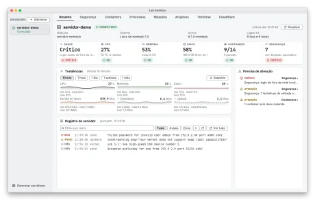</a> <a href="docs/img/resumo-escuro.png">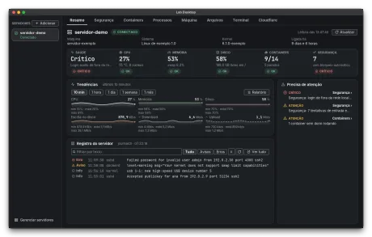</a><br /><sub>Resumo: saúde, seis gráficos de tendência, registro do servidor e o que pede atenção.</sub></td>
    <td align="center" valign="top"><a href="docs/img/relatorio-claro.png">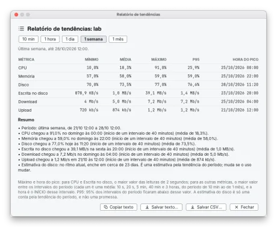</a> <a href="docs/img/relatorio-escuro.png">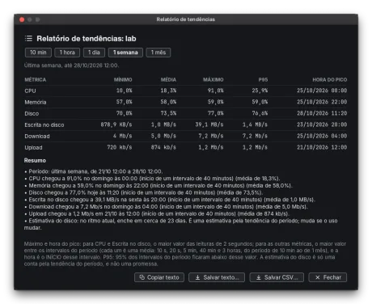</a><br /><sub>Relatório de tendências da última semana: mínimo, média, máximo, P95 e hora do pico.</sub></td>
  </tr>
  <tr>
    <td align="center" valign="top"><a href="docs/img/servidor-containers-claro.png">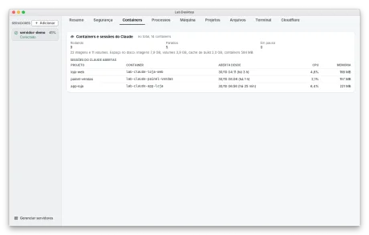</a> <a href="docs/img/servidor-containers-escuro.png">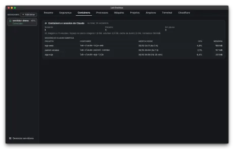</a><br /><sub>Containers: quantos rodam e as sessões do Claude abertas (se o servidor tem Claude).</sub></td>
    <td align="center" valign="top"><a href="docs/img/servidor-seguranca-claro.png">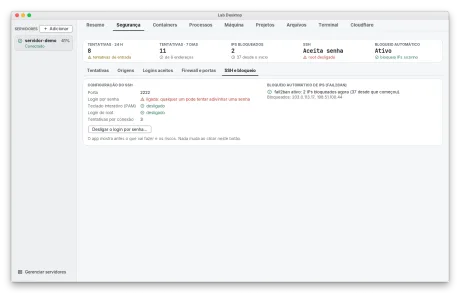</a> <a href="docs/img/servidor-seguranca-escuro.png">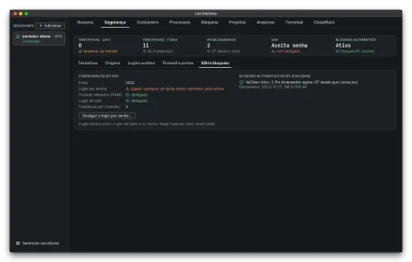</a><br /><sub>Segurança: SSH e bloqueio, com o login por senha ligado e o botão para desligá-lo.</sub></td>
  </tr>
  <tr>
    <td align="center" valign="top"><a href="docs/img/servidor-maquina-claro.png">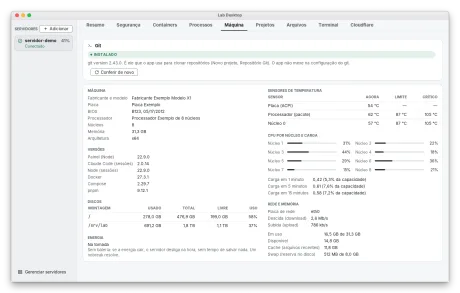</a> <a href="docs/img/servidor-maquina-escuro.png">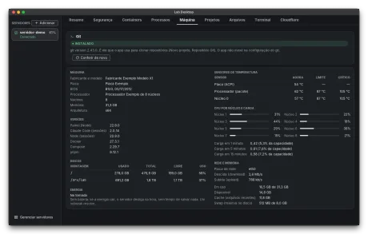</a><br /><sub>Máquina: versões, discos, temperatura, CPU por núcleo, rede, memória e o bloco do Git, que diz se ele está instalado.</sub></td>
    <td align="center" valign="top"><a href="docs/img/processos-claro.png">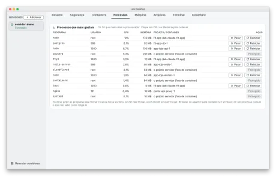</a> <a href="docs/img/processos-escuro.png">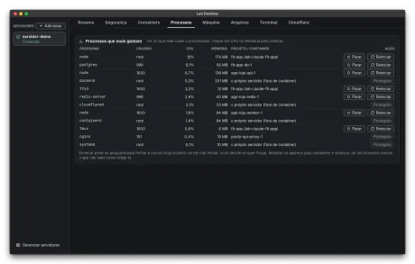</a><br /><sub>Processos: os que mais gastam, com Parar e Reiniciar para containers e Protegido para o resto.</sub></td>
  </tr>
  <tr>
    <td align="center" valign="top"><a href="docs/img/servidor-projetos-claro.png">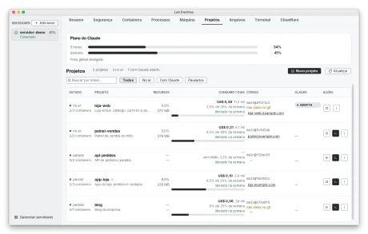</a> <a href="docs/img/servidor-projetos-escuro.png">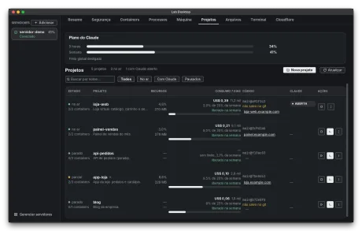</a><br /><sub>Projetos: a lista com consumo, código, endereço e o botão Novo projeto.</sub></td>
    <td align="center" valign="top"><a href="docs/img/servidor-arquivos-claro.png">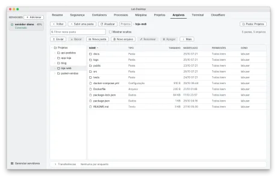</a> <a href="docs/img/servidor-arquivos-escuro.png">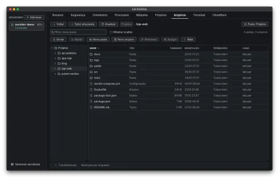</a><br /><sub>Arquivos: o gerenciador por SFTP, com árvore de pastas, Enviar e Baixar.</sub></td>
  </tr>
  <tr>
    <td align="center" valign="top"><a href="docs/img/servidor-terminal-claro.png">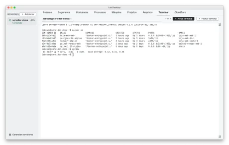</a> <a href="docs/img/servidor-terminal-escuro.png">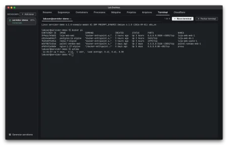</a><br /><sub>Terminal: um terminal de verdade no servidor, com várias abas.</sub></td>
    <td></td>
  </tr>
</table>

### Projetos

A página de cada projeto.

<table>
  <tr>
    <td align="center" valign="top"><a href="docs/img/projeto-visao-geral-claro.png">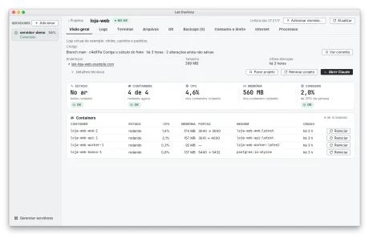</a> <a href="docs/img/projeto-visao-geral-escuro.png">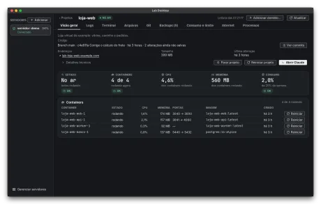</a><br /><sub>Visão geral: a linha Código (branch, último commit, alterações), endereços, containers e o consumo.</sub></td>
    <td align="center" valign="top"><a href="docs/img/projeto-logs-claro.png">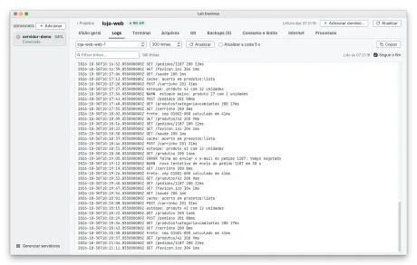</a> <a href="docs/img/projeto-logs-escuro.png">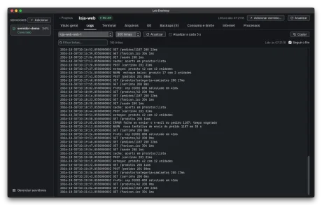</a><br /><sub>Logs: as linhas de um container, com filtro e atualização a cada 5 segundos se você quiser.</sub></td>
  </tr>
  <tr>
    <td align="center" valign="top"><a href="docs/img/projeto-terminal-claro.png">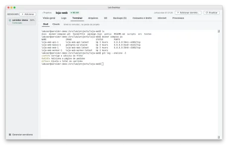</a> <a href="docs/img/projeto-terminal-escuro.png">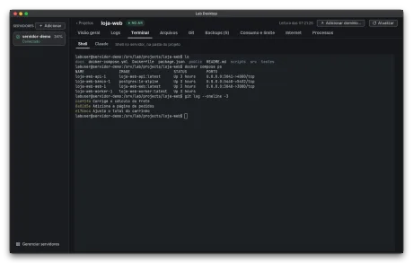</a><br /><sub>Terminal: um shell já na pasta do projeto.</sub></td>
    <td align="center" valign="top"><a href="docs/img/projeto-arquivos-claro.png">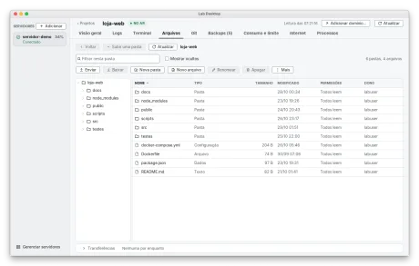</a> <a href="docs/img/projeto-arquivos-escuro.png">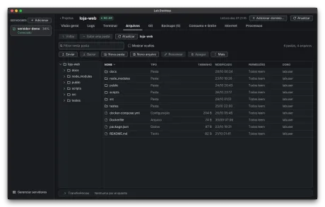</a><br /><sub>Arquivos: só a pasta do projeto.</sub></td>
  </tr>
  <tr>
    <td align="center" valign="top"><a href="docs/img/projeto-processos-claro.png">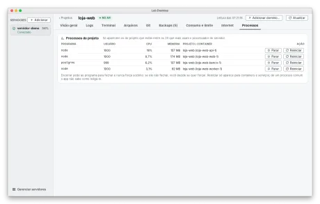</a> <a href="docs/img/projeto-processos-escuro.png">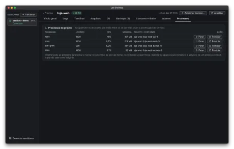</a><br /><sub>Processos do projeto: Parar e Reiniciar cada container.</sub></td>
    <td align="center" valign="top"><a href="docs/img/projeto-backups-claro.png">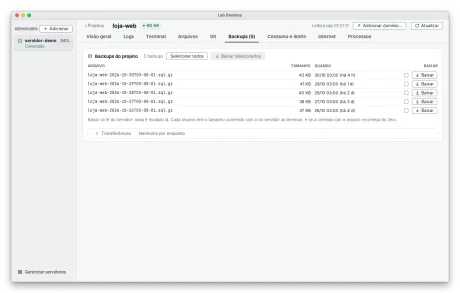</a> <a href="docs/img/projeto-backups-escuro.png">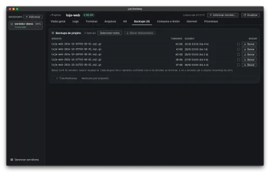</a><br /><sub>Backups: a lista dos arquivos de backup e Baixar, um a um ou vários.</sub></td>
  </tr>
  <tr>
    <td align="center" valign="top"><a href="docs/img/projeto-internet-claro.png">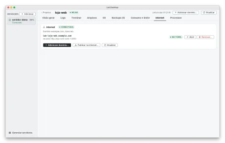</a> <a href="docs/img/projeto-internet-escuro.png">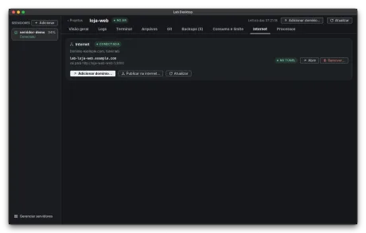</a><br /><sub>Internet: os endereços do projeto, Adicionar domínio e Publicar na internet.</sub></td>
    <td></td>
  </tr>
</table>

### Git do projeto

Ler os commits, achar o repositório e criar um repositório novo. O app não faz push, não liga a remoto e não aprova nem mescla nada.

<table>
  <tr>
    <td align="center" valign="top"><a href="docs/img/projeto-git-commits-claro.png">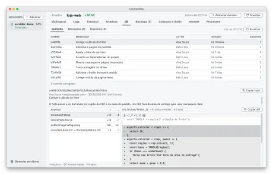</a> <a href="docs/img/projeto-git-commits-escuro.png">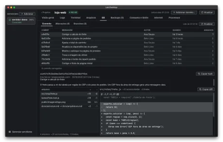</a><br /><sub>Aba Git, Commits: a lista, o commit escolhido, os arquivos que ele mudou e o diff com + e -.</sub></td>
    <td align="center" valign="top"><a href="docs/img/projeto-git-alteracoes-claro.png">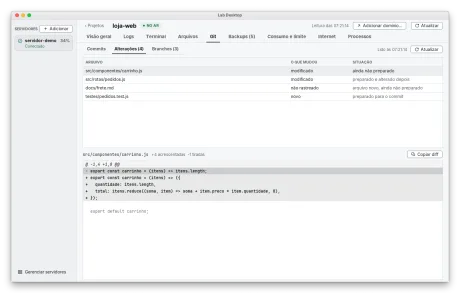</a> <a href="docs/img/projeto-git-alteracoes-escuro.png">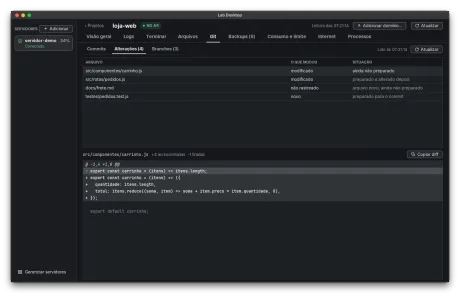</a><br /><sub>Alterações: o que ainda não foi commitado, com o diff de cada arquivo.</sub></td>
  </tr>
  <tr>
    <td align="center" valign="top"><a href="docs/img/projeto-git-branches-claro.png">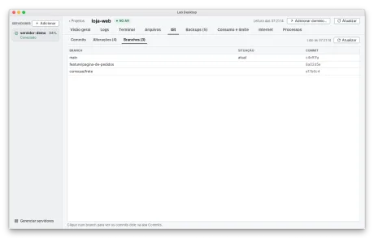</a> <a href="docs/img/projeto-git-branches-escuro.png">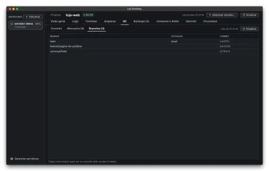</a><br /><sub>Branches: os branches do repositório, com o atual marcado.</sub></td>
    <td align="center" valign="top"><a href="docs/img/projeto-git-subpasta-claro.png">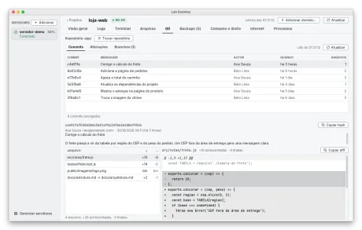</a> <a href="docs/img/projeto-git-subpasta-escuro.png">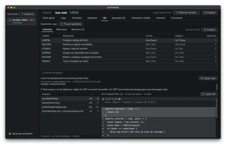</a><br /><sub>Repositório em subpasta: o app lê o app/ e mostra Trocar repositório.</sub></td>
  </tr>
  <tr>
    <td align="center" valign="top"><a href="docs/img/projeto-git-escolher-claro.png">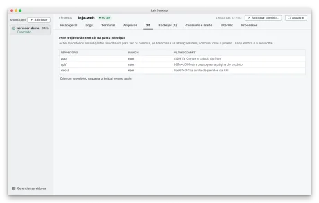</a> <a href="docs/img/projeto-git-escolher-escuro.png">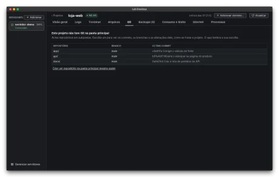</a><br /><sub>Vários repositórios em subpastas: você escolhe um, e o app lembra a escolha.</sub></td>
    <td align="center" valign="top"><a href="docs/img/projeto-git-segredo-claro.png">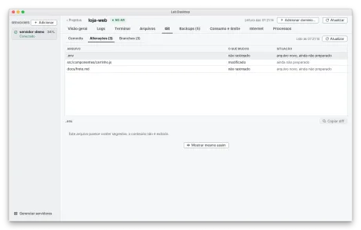</a> <a href="docs/img/projeto-git-segredo-escuro.png">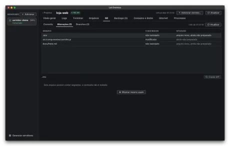</a><br /><sub>Arquivo com cara de segredo (.env): o conteúdo não aparece até você clicar em Mostrar mesmo assim.</sub></td>
  </tr>
  <tr>
    <td align="center" valign="top"><a href="docs/img/projeto-git-sem-git-claro.png">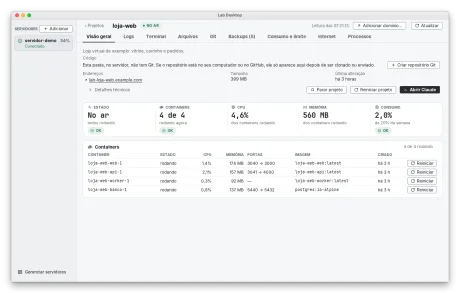</a> <a href="docs/img/projeto-git-sem-git-escuro.png">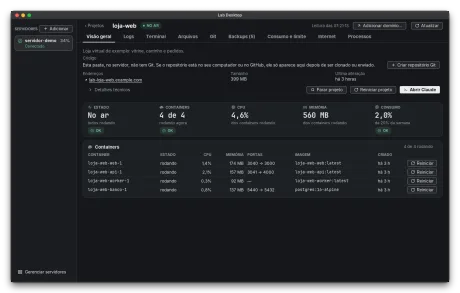</a><br /><sub>Pasta sem Git: a linha Código diz isso e oferece Criar repositório Git.</sub></td>
    <td align="center" valign="top"><a href="docs/img/projeto-git-nao-instalado-claro.png">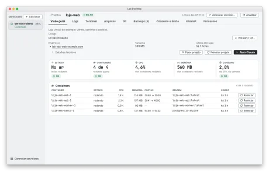</a> <a href="docs/img/projeto-git-nao-instalado-escuro.png">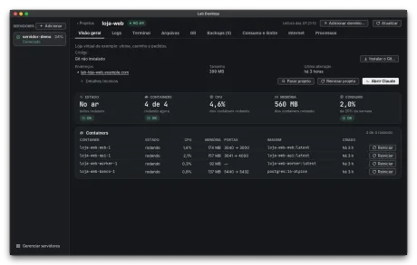</a><br /><sub>Git não instalado no servidor: a linha Código oferece Instalar o Git.</sub></td>
  </tr>
  <tr>
    <td align="center" valign="top"><a href="docs/img/projeto-git-outro-usuario-claro.png">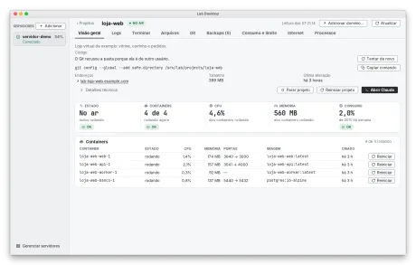</a> <a href="docs/img/projeto-git-outro-usuario-escuro.png">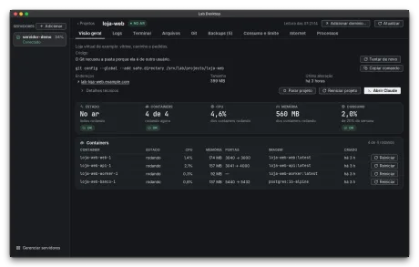</a><br /><sub>Pasta de outro usuário: o Git recusa e o app mostra o comando para você copiar (ele nunca o executa).</sub></td>
    <td align="center" valign="top"><a href="docs/img/git-criar-repositorio-claro.png"></a> <a href="docs/img/git-criar-repositorio-escuro.png"></a><br /><sub>Criar repositório Git: a conferência só de leitura, com o que entra, o que fica de fora e os arquivos grandes.</sub></td>
  </tr>
  <tr>
    <td align="center" valign="top"><a href="docs/img/git-criar-segredo-claro.png"></a> <a href="docs/img/git-criar-segredo-escuro.png"></a><br /><sub>Criar repositório numa pasta que já tem .gitignore: o app completa com as regras de segredos (.env, chaves) e mostra as linhas.</sub></td>
    <td align="center" valign="top"><a href="docs/img/git-criar-identidade-claro.png"></a> <a href="docs/img/git-criar-identidade-escuro.png"></a><br /><sub>Criar repositório quando o Git não sabe quem você é: nome e e-mail gravados só neste repositório.</sub></td>
  </tr>
  <tr>
    <td align="center" valign="top"><a href="docs/img/git-criar-mesmo-assim-claro.png"></a> <a href="docs/img/git-criar-mesmo-assim-escuro.png"></a><br /><sub>Já existe repositório numa subpasta: criar na pasta principal exige marcar uma caixa de confirmação.</sub></td>
    <td align="center" valign="top"><a href="docs/img/git-instalar-claro.png"></a> <a href="docs/img/git-instalar-escuro.png"></a><br /><sub>Instalar o Git: os comandos exatos aparecem antes, e você pode só copiá-los.</sub></td>
  </tr>
</table>

### Encerrar e reiniciar processos

Sempre com uma confirmação, e o app nunca força sozinho.

<table>
  <tr>
    <td align="center" valign="top"><a href="docs/img/processo-encerrar-claro.png"></a> <a href="docs/img/processo-encerrar-escuro.png"></a><br /><sub>Confirmação de Encerrar: nome, número, usuário, projeto ou container e hora de início; pede ao programa para fechar (SIGTERM).</sub></td>
    <td></td>
  </tr>
</table>

### Cloudflare

Endereços na internet para os projetos, pela sua conta da Cloudflare.

<table>
  <tr>
    <td align="center" valign="top"><a href="docs/img/servidor-cloudflare-claro.png"></a> <a href="docs/img/servidor-cloudflare-escuro.png"></a><br /><sub>Aba Cloudflare: conta conectada, domínio, túnel e os endereços que o app criou.</sub></td>
    <td align="center" valign="top"><a href="docs/img/cloudflare-conectar-claro.png"></a> <a href="docs/img/cloudflare-conectar-escuro.png"></a><br /><sub>Conectar a Cloudflare: o token fica escondido e só no cofre; a janela lista as permissões mínimas.</sub></td>
  </tr>
  <tr>
    <td align="center" valign="top"><a href="docs/img/cloudflare-tunel-configuracao-claro.png"></a> <a href="docs/img/cloudflare-tunel-configuracao-escuro.png"></a><br /><sub>Escolher o domínio e o túnel (aqui gerido por arquivo no servidor) e conferir.</sub></td>
    <td align="center" valign="top"><a href="docs/img/cloudflare-adicionar-dominio-passo-1-claro.png"></a> <a href="docs/img/cloudflare-adicionar-dominio-passo-1-escuro.png"></a><br /><sub>Adicionar domínio, passo 1 de 5: a conta.</sub></td>
  </tr>
  <tr>
    <td align="center" valign="top"><a href="docs/img/cloudflare-adicionar-dominio-claro.png"></a> <a href="docs/img/cloudflare-adicionar-dominio-escuro.png"></a><br /><sub>Adicionar domínio, passo 3: o nome do endereço.</sub></td>
    <td align="center" valign="top"><a href="docs/img/cloudflare-adicionar-dominio-servico-claro.png"></a> <a href="docs/img/cloudflare-adicionar-dominio-servico-escuro.png"></a><br /><sub>Adicionar domínio, passo 4: qual serviço e porta vão para a internet.</sub></td>
  </tr>
  <tr>
    <td align="center" valign="top"><a href="docs/img/cloudflare-publicar-claro.png"></a> <a href="docs/img/cloudflare-publicar-escuro.png"></a><br /><sub>Publicar na internet: a prévia de tudo o que muda (compose, túnel e DNS) antes do clique.</sub></td>
    <td></td>
  </tr>
</table>

### Conectar a um servidor

Direto por SSH, pelo AWS Session Manager ou pelo túnel da Cloudflare, sem abrir a porta do SSH.

<table>
  <tr>
    <td align="center" valign="top"><a href="docs/img/servidores-lista-claro.png"></a> <a href="docs/img/servidores-lista-escuro.png"></a><br /><sub>Lista de servidores: conectado direto, com o selo Sem porta aberta (SSM) e Protegido.</sub></td>
    <td align="center" valign="top"><a href="docs/img/servidor-adicionar-passo-1-claro.png"></a> <a href="docs/img/servidor-adicionar-passo-1-escuro.png"></a><br /><sub>Adicionar servidor, passo 1: nome, usuário, Como conectar (Direto), endereço e Servidor protegido.</sub></td>
  </tr>
  <tr>
    <td align="center" valign="top"><a href="docs/img/como-conectar-direto-claro.png"></a> <a href="docs/img/como-conectar-direto-escuro.png"></a><br /><sub>Como conectar, Direto (SSH), o padrão: só o endereço e a porta; nada de túnel.</sub></td>
    <td align="center" valign="top"><a href="docs/img/como-conectar-ssm-claro.png"></a> <a href="docs/img/como-conectar-ssm-escuro.png"></a><br /><sub>Como conectar pelo AWS Session Manager: instância, região, perfil e porta.</sub></td>
  </tr>
  <tr>
    <td align="center" valign="top"><a href="docs/img/como-conectar-ssm-config-claro.png"></a> <a href="docs/img/como-conectar-ssm-config-escuro.png"></a><br /><sub>Conferir as ferramentas neste computador: o aws foi achado, o plugin falta e o passo de instalar aparece como texto.</sub></td>
    <td align="center" valign="top"><a href="docs/img/como-conectar-editar-ssm-claro.png"></a> <a href="docs/img/como-conectar-editar-ssm-escuro.png"></a><br /><sub>Editar um servidor que usa o Session Manager.</sub></td>
  </tr>
  <tr>
    <td align="center" valign="top"><a href="docs/img/como-conectar-cloudflare-claro.png"></a> <a href="docs/img/como-conectar-cloudflare-escuro.png"></a><br /><sub>Como conectar pelo túnel da Cloudflare: o endereço do túnel.</sub></td>
    <td align="center" valign="top"><a href="docs/img/como-conectar-cloudflare-config-claro.png"></a> <a href="docs/img/como-conectar-cloudflare-config-escuro.png"></a><br /><sub>Conferir as ferramentas: o cloudflared foi achado neste computador.</sub></td>
  </tr>
  <tr>
    <td align="center" valign="top"><a href="docs/img/como-conectar-editar-cloudflare-claro.png"></a> <a href="docs/img/como-conectar-editar-cloudflare-escuro.png"></a><br /><sub>Editar um servidor que usa a Cloudflare.</sub></td>
    <td align="center" valign="top"><a href="docs/img/sem-porta-aberta-claro.png"></a> <a href="docs/img/sem-porta-aberta-escuro.png"></a><br /><sub>O selo Sem porta aberta no cartão de cada servidor.</sub></td>
  </tr>
  <tr>
    <td align="center" valign="top"><a href="docs/img/servidor-confiar-impressao-claro.png"></a> <a href="docs/img/servidor-confiar-impressao-escuro.png"></a><br /><sub>Confiar no servidor: a impressão digital e o comando para conferi-la no próprio servidor.</sub></td>
    <td align="center" valign="top"><a href="docs/img/servidor-adicionar-senha-claro.png"></a> <a href="docs/img/servidor-adicionar-senha-escuro.png"></a><br /><sub>Primeira conexão: a senha vale uma vez, fica escondida e não é guardada.</sub></td>
  </tr>
  <tr>
    <td align="center" valign="top"><a href="docs/img/servidor-adicionar-pergunta-agente-claro.png"></a> <a href="docs/img/servidor-adicionar-pergunta-agente-escuro.png"></a><br /><sub>No fim, o app pergunta se você quer desligar o login por senha (o padrão é manter).</sub></td>
    <td align="center" valign="top"><a href="docs/img/servidor-instalar-chave-claro.png"></a> <a href="docs/img/servidor-instalar-chave-escuro.png"></a><br /><sub>Consertar Chave recusada: instalar a chave com a senha, só se o servidor for o que você confirmou.</sub></td>
  </tr>
  <tr>
    <td align="center" valign="top"><a href="docs/img/seguranca-desligar-senha-claro.png"></a> <a href="docs/img/seguranca-desligar-senha-escuro.png"></a><br /><sub>Desligar o login por senha: o que será feito, os riscos, o comando para reverter e o nome do servidor para confirmar.</sub></td>
    <td align="center" valign="top"><a href="docs/img/servidor-editar-claro.png"></a> <a href="docs/img/servidor-editar-escuro.png"></a><br /><sub>Editar servidor: nome, endereço, modo de conexão e acesso.</sub></td>
  </tr>
  <tr>
    <td align="center" valign="top"><a href="docs/img/servidor-editar-protegido-claro.png"></a> <a href="docs/img/servidor-editar-protegido-escuro.png"></a><br /><sub>Editar servidor com a caixa Servidor protegido marcada.</sub></td>
    <td align="center" valign="top"><a href="docs/img/servidor-remover-claro.png"></a> <a href="docs/img/servidor-remover-escuro.png"></a><br /><sub>Remover servidor: tira da lista e, se você quiser, apaga a chave e revoga o acesso.</sub></td>
  </tr>
  <tr>
    <td align="center" valign="top"><a href="docs/img/servidor-protegido-claro.png"></a> <a href="docs/img/servidor-protegido-escuro.png"></a><br /><sub>O selo Protegido no cartão: o app só lê e conecta nesse servidor.</sub></td>
    <td align="center" valign="top"><a href="docs/img/faixa-ritmo-lento-claro.png"></a> <a href="docs/img/faixa-ritmo-lento-escuro.png"></a><br /><sub>Servidor que não volta: depois de 12 falhas seguidas, tentativas a cada 5 minutos, com desde quando e a causa.</sub></td>
  </tr>
  <tr>
    <td align="center" valign="top"><a href="docs/img/faixa-ritmo-lento-aws-claro.png"></a> <a href="docs/img/faixa-ritmo-lento-aws-escuro.png"></a><br /><sub>A mesma faixa quando o login da AWS expirou: o app mostra o comando para você copiar e rodar.</sub></td>
    <td></td>
  </tr>
</table>

### Agente e este computador

O agente de monitoramento é opcional e só é instalado depois da sua confirmação.

<table>
  <tr>
    <td align="center" valign="top"><a href="docs/img/o-que-instalar-claro.png"></a> <a href="docs/img/o-que-instalar-escuro.png"></a><br /><sub>O que instalar neste servidor: completo, escolher os itens ou só SSH.</sub></td>
    <td align="center" valign="top"><a href="docs/img/instalar-agente-confirmacao-claro.png"></a> <a href="docs/img/instalar-agente-confirmacao-escuro.png"></a><br /><sub>Confirmação de instalar o agente: tudo o que foi conferido, os passos e os avisos de segurança.</sub></td>
  </tr>
  <tr>
    <td align="center" valign="top"><a href="docs/img/este-computador-claro.png"></a> <a href="docs/img/este-computador-escuro.png"></a><br /><sub>Este computador: o laboratório rodando no Docker local, sem servidor e sem SSH.</sub></td>
    <td align="center" valign="top"><a href="docs/img/preparar-este-computador-claro.png"></a> <a href="docs/img/preparar-este-computador-escuro.png"></a><br /><sub>Preparar este computador: o app só confere o que falta e mostra o que vai fazer antes de criar o laboratório.</sub></td>
  </tr>
</table>

### Novo projeto

Criar do zero, importar ou adicionar um container.

<table>
  <tr>
    <td align="center" valign="top"><a href="docs/img/novo-projeto-claro.png"></a> <a href="docs/img/novo-projeto-escuro.png"></a><br /><sub>Novo projeto: criar do zero, importar ou adicionar um container.</sub></td>
    <td align="center" valign="top"><a href="docs/img/novo-projeto-criar-claro.png"></a> <a href="docs/img/novo-projeto-criar-escuro.png"></a><br /><sub>Criar do zero: o nome, onde a pasta fica e o que vem pronto.</sub></td>
  </tr>
  <tr>
    <td align="center" valign="top"><a href="docs/img/novo-projeto-importar-claro.png"></a> <a href="docs/img/novo-projeto-importar-escuro.png"></a><br /><sub>Importar por Git: o endereço do repositório e o que vai acontecer.</sub></td>
    <td align="center" valign="top"><a href="docs/img/novo-projeto-importar-pasta-claro.png"></a> <a href="docs/img/novo-projeto-importar-pasta-escuro.png"></a><br /><sub>Importar uma pasta do seu computador: sem node_modules, sem .git e sem arquivos de segredo, a menos que você marque.</sub></td>
  </tr>
  <tr>
    <td align="center" valign="top"><a href="docs/img/novo-projeto-container-claro.png"></a> <a href="docs/img/novo-projeto-container-escuro.png"></a><br /><sub>Adicionar container (Redis): a diferença no docker-compose.yml aparece antes de gravar.</sub></td>
    <td></td>
  </tr>
</table>

### Ajustes, Sobre e Ajuda

Tema, abas, informações do app e a Ajuda que vem dentro dele.

<table>
  <tr>
    <td align="center" valign="top"><a href="docs/img/tema-claro.png"></a> <a href="docs/img/tema-escuro.png"></a><br /><sub>Tema claro, escuro ou o do sistema, e o tamanho do texto.</sub></td>
    <td align="center" valign="top"><a href="docs/img/ordem-das-abas-claro.png"></a> <a href="docs/img/ordem-das-abas-escuro.png"></a><br /><sub>Ordem e visibilidade das abas do servidor e do projeto.</sub></td>
  </tr>
  <tr>
    <td align="center" valign="top"><a href="docs/img/ajustes-terminal-claro.png"></a> <a href="docs/img/ajustes-terminal-escuro.png"></a><br /><sub>Ajustes, Terminal: as preferências do terminal e, em "Ao sair de um projeto", a caixa que volta a perguntar.</sub></td>
    <td align="center" valign="top"><a href="docs/img/sair-do-projeto-claro.png"></a> <a href="docs/img/sair-do-projeto-escuro.png"></a><br /><sub>Sair de um projeto com terminal aberto: o app pergunta, e a caixa "Não perguntar de novo" vem desmarcada.</sub></td>
  </tr>
  <tr>
    <td align="center" valign="top"><a href="docs/img/sair-do-projeto-marcada-claro.png"></a> <a href="docs/img/sair-do-projeto-marcada-escuro.png"></a><br /><sub>A mesma pergunta com a caixa marcada: só vale se você confirmar a saída (Cancelar ignora a marca).</sub></td>
    <td align="center" valign="top"><a href="docs/img/ajustes-sobre-claro.png"></a> <a href="docs/img/ajustes-sobre-escuro.png"></a><br /><sub>Sobre: versão, Java, sistema, pasta de dados, licença MIT e licenças de terceiros.</sub></td>
  </tr>
  <tr>
    <td align="center" valign="top"><a href="docs/img/ajuda-claro.png"></a> <a href="docs/img/ajuda-escuro.png"></a><br /><sub>Ajuda no app: como conectar a um servidor.</sub></td>
    <td align="center" valign="top"><a href="docs/img/ajuda-git-claro.png"></a> <a href="docs/img/ajuda-git-escuro.png"></a><br /><sub>Ajuda no app: Git do projeto.</sub></td>
  </tr>
  <tr>
    <td align="center" valign="top"><a href="docs/img/ajuda-ritmo-lento-claro.png"></a> <a href="docs/img/ajuda-ritmo-lento-escuro.png"></a><br /><sub>Ajuda no app: o que fazer quando aparece Sem conexão.</sub></td>
    <td></td>
  </tr>
</table>

## Limites de hoje

- O pacote do agente de monitoramento não vem neste repositório: sem ele o app avisa e segue com terminal, arquivos e segurança.
- A conexão por AWS e por Cloudflare foi testada só com programas de mentira e um processo de verdade; falta prova contra a AWS e a Cloudflare reais.
- O Git do projeto lê e cria o repositório local. Aprovar e mesclar, desfazer e publicar não existem.
- O app procura o repositório Git da pasta do projeto NO SERVIDOR; um repositório que está só no seu computador ou no GitHub só aparece depois de ser clonado ou enviado para lá.
- O CI do GitHub ainda não rodou e os instaladores não têm assinatura de código paga.
- No Windows e no Linux o código é o mesmo, mas a prova de ponta a ponta foi feita no Mac.

## Como conferir na prática

Faça num servidor de TESTE (ou num projeto de teste), nunca em produção: criar o repositório escreve na pasta do projeto.

1. **Criar um repositório.** Crie um projeto de teste e, no terminal dele, faça `printf "SENHA=1\n" > .env`, `printf "ola\n" > a.txt` e `head -c 6000000 /dev/zero > grande.bin`. Na Visão geral, a linha Código diz "Sem Git". Clique em "Criar repositório Git": a janela confere sem escrever nada (confira com `ls -a` que não existe `.git` ainda), mostra o `.env` fora, o `grande.bin` na lista de arquivos grandes e as linhas do `.gitignore`. Clique em criar: `git log --oneline` mostra um commit "Primeiro commit", `git ls-files` lista só `.gitignore` e `a.txt`, e `git config --global user.name` não mudou.
2. **Ver os commits.** A linha Código passa a mostrar o branch e o último commit; "Ver commits" abre a aba Git. Clique num commit: mensagem, arquivos e diff. Edite `a.txt` no terminal e clique em Atualizar: a aba Alterações mostra o arquivo.
3. **Repositório em subpasta.** Num projeto sem `.git` na pasta principal mas com `app/.git`, a aba Git mostra "Repositório: app/" e os commits dele, e "Criar repositório Git" não aparece. Com dois repositórios, a aba mostra a lista e só lê o que você escolher. Fechar e abrir o app mantém a escolha.
4. **Reconexão.** Cadastre um servidor de teste pelo AWS Session Manager com um ID de instância que não existe (invente um) e deixe o app aberto: nos primeiros minutos a faixa diz "Reconectando (tentativa N)"; depois de 12 falhas seguidas ela passa a "Tentando de novo a cada 5 min", com a causa. No `ps` do computador, o `aws ssm start-session` aparece uma vez a cada 5 minutos. "Tentar agora" faz uma tentativa na hora e volta ao ritmo normal.
5. **Encerrar um processo.** Num servidor de teste, deixe um `sleep 600` rodando, abra Servidor > Processos, clique em Encerrar e confira nome, número e hora na confirmação.

Os testes do app gravam as telas em `build/telas/` (tema claro e escuro) e as imagens da galeria em `build/galeria/`.

## Documentação

`docs/INSTALAR.md` (instalar no Windows e no Mac, para quem não é técnico), `docs/CI.md` (o CI, os instaladores e a assinatura de código), `docs/ARQUITETURA.md` (o desenho) e `docs/CONTRATO-API.md` (as rotas do agente). Também: `CONTRIBUTING.md` (como contribuir) e `SECURITY.md` (como relatar uma vulnerabilidade). Os créditos e os textos das licenças de terceiros estão em `THIRD-PARTY-NOTICES.md` e na pasta `licencas/`.

## Recursos opcionais do Claude

O Claude é opcional e não é um módulo à parte: o app é um só. O sinal de que o servidor tem Claude é `recursos.claude` de `GET /api/versao` (`RecursosDoAgente`); sem ele, tudo o que está abaixo fica escondido e o resto funciona igual. A fronteira, por arquivo:

| Parte | Classes e telas do Claude |
|---|---|
| Modelo e API (`api`, `api.modelo`) | `TelaClaude`, `SessaoAberta`, `SessaoProjeto`, `InfoSessao`, `LoginPendente`, `TokensDoProjeto` (consumo e limite) e os campos de Claude de `Projeto`, `DetalheProjeto`, `Detalhe`, `RecursosDoAgente` e `VersaoAgente`; em `ClienteApi`, as rotas `/api/projetos/:p/claude/*` e `/api/projetos/:p/limite*` |
| Estado e ações (`servidor`) | `ModeloDaSessao`, os tópicos de tela e de limites em `Topico` e `ServidorLab`, e as ações de sessão e limite de `AcoesDoServidor` |
| Telas (`ui.telas`) | a aba **Consumo e limite** (`PaginaConsumo`, `ModeloDeConsumo`, `PainelDeCredito`), o seletor **Shell \| Claude** de `PaginaTerminalDoProjeto`, o alerta de pergunta e de login pendente (`AlertaDaPagina`), os selos e botões de sessão da lista de projetos (`LinhaProjetoVisual`, `LinhaDeProjeto`, `ColunasDaLista`, `ListagemDeProjetos`), a faixa de sessões pausadas (`FaixaAviso`) e `PaginaVisaoGeral` |
| Diálogos (`ui.dialogos`) | `DialogoLimite` e, em `DialogoNovoProjeto`, a caixa "Incluir guia para o Claude" |
| Terminal (`terminal`, `ssh`) | o modo Claude: `LinhaDePty` (anexar à sessão `tmux` do container `lab-claude-<projeto>`), `ComandoDeTerminal.SessaoDoClaude` e a classificação de saída de `ClassificadorDeSaida` |
| Projetos (`projetos`) | `GabaritoDoProjeto`: o esqueleto de projeto criado SEM guia para IA (o guia, quando pedido, é escrito pelo agente) |
| Ajuda | os trechos "Claude" de `agente.txt`, `logs-e-consumo.txt` e `terminal.txt` |

Hoje o Claude não é um módulo à parte: cerca de um em cada oito arquivos de `src/main/java` e de `src/test/java` cita o Claude. Separá-lo num módulo opcional pediria uma interface que as telas do projeto consultam para pedir as peças do Claude; o sinal em tempo de execução já existe (`recursos.claude`) e o teste `TelaServidorSemClaudeTest` prova a tela sem Claude.

## Desenvolvimento

Use um JDK 21 completo (`javac`, `jlink`, `jpackage`) e defina `JAVA_HOME` para ele; o Gradle 9 usa por padrão o JDK que achar primeiro. Em cada comando, no Mac com o Homebrew, por exemplo:

```sh
export JAVA_HOME=/opt/homebrew/opt/openjdk@21/libexec/openjdk.jdk/Contents/Home
export PATH="$JAVA_HOME/bin:$PATH"
```

| Comando | O que faz |
|---|---|
| `./gradlew build` | compila, roda os testes e confere as dependências contra `gradle/verification-metadata.xml` |
| `./gradlew test` | só os testes (o Argon2id de produção leva cerca de 1 s; o resto usa o KDF mínimo) |
| `./gradlew run --args="--pasta cofre-dev"` | abre o app com uma pasta de dados de desenvolvimento (já ignorada pelo git) |
| `./gradlew empacotar` | gera o instalador DO sistema onde roda, com o Java junto, em `build/instaladores/`: `.dmg` no Mac, `.msi` e `.zip` portátil no Windows (precisa do WiX 3), `.tar.gz` no Linux, e `SHA256SUMS-*.txt` (ARQUITETURA 11.4). `jpackageImagem` gera só o `.app` ou a pasta; `verificarModulos` confere os módulos do `jlink` com o `jdeps`; `conferirImagem` roda o app da imagem com `--autoteste` (sem janela) |
| `./gradlew test -Plabdesktop.laf=generico` | a suíte inteira com o LaF do Windows e do Linux (`FlatLightLaf`/`FlatDarkLaf`) num Mac; os PNGs vão para `build/telas-generico/` |
| `scripts/gerar-galeria.sh` | depois de `./gradlew test`, copia as telas de `build/galeria/` (janela do macOS desenhada em volta, dados inventados) para `docs/img/` e gera as miniaturas de 460 px em `docs/img/mini/` (precisa do `cwebp`) |
| `./gradlew provaWindows` | as provas que só rodam num Windows de verdade (ACL do NTFS, junção, registro do tema); em outro sistema não roda nada |
| `build/install/lab-desktop/bin/lab-desktop --versao` / `--autoteste` | imprime a versão / confere módulos, bibliotecas, cofre, SSH, tema e PTY SEM janela (é o que o CI roda dentro do instalador) |
| `./gradlew run -Plabdesktop.debug=true --args="--pasta cofre-dev"` | liga o log de requisições: cada chamada ao agente vira uma linha no log do app (`[lab] GET /api/projetos -> 200 em 54 ms`; sem query, token nem corpo). Também vale `-Dlabdesktop.debug=true` ou `LABDESKTOP_DEBUG=1`. |
| `./gradlew run -Plabdesktop.acoes=false` | DESLIGA as ações de escrita da lista de projetos (iniciar, parar, Abrir Claude, Retomar, Novo projeto, Importar, Adicionar container...), que vêm LIGADAS por padrão e continuam com a confirmação de cada ação; os botões que a trava desliga APARECEM desligados, com a explicação, e não somem |
| `./gradlew test -Plabdesktop.dockerReal=true --tests '*DockerDeVerdade*'` | roda o laboratório local e o Novo projeto (a rede `<nome>_default` com os rótulos do compose e o `docker compose config` dos quatro modelos de container) com o Docker de VERDADE deste computador (precisa do Docker no ar; usa só containers, rede, volume e imagem `labteste-*`, e o projeto `labteste-novo`, e os remove no fim). Sem a propriedade esses testes são pulados: o build normal nunca toca no seu Docker. Também precisa do pacote do agente (veja abaixo) |
| `./gradlew empacotarAgente -PpainelDir=<pasta do repositório do agente> -PagenteCommit=<hash>` | monta o pacote do agente que o instalador envia ao servidor (`src/main/resources/agente/`), no commit indicado |
| `scripts/capturar-fixtures.sh [alvo-ssh]` | grava respostas REAIS do agente (só `GET`, por `ssh <alvo> curl`) em `src/test/resources/lab-real/` (ignorada pelo git: contém nomes de projetos de verdade); é o que destrava os testes de `ContratoComFixturesReaisTest` |
| `python3 -I scripts/gerar-lista-de-senhas.py <pasta>` | regenera `senhas-comuns.txt`, a lista de senhas comuns da régua da senha-mestra (origem e licença no cabeçalho do arquivo) |

Os testes de interface desenham as telas e os diálogos sem abrir janela e gravam PNGs em `build/telas/` (tema claro e escuro); abra-os para conferir o visual depois de mexer em layout. Em `run`, o app liga o vigia da EDT (`labdesktop.dev=true`), que acusa no log qualquer travada de mais de meio segundo na thread da interface.

**O pacote do agente não vem no repositório.** O instalador do agente de monitoramento envia um `tar.gz` montado a partir do repositório do agente (opcional, à parte deste repositório). Sem ele, o app abre e funciona; "Instalar agente" (e "Criar meu laboratório local") só avisa "Esta versão do app foi compilada sem o agente de monitoramento...", e a tela Ajustes, Sobre mostra "não incluído". Os testes do instalador usam um pacote SINTÉTICO de teste (`src/test/resources/agente-teste/`, só no classpath de teste, que NÃO é o agente), e os testes que conferem o conteúdo do agente de verdade (`PacoteDoAgenteTest`, `GabaritoIgualAoDoAgenteTest`) ficam ignorados enquanto o pacote real não existir (`./gradlew empacotarAgente`).

**Testes pulados**: os de `ContratoComFixturesReaisTest` (só rodam com as respostas reais do agente em `src/test/resources/lab-real/`), os 2 de `ProvisionarCofreDev` (uma ferramenta manual que só roda com `LABDEV_FASE`, veja "Cofre de teste"), os que só rodam com o Docker de verdade (`-Plabdesktop.dockerReal=true`), os que conferem o agente de verdade (sem o pacote real) e o `GabaritoIgualAoDoAgenteTest`, que só roda onde há `node` no PATH.

**CI** (`docs/CI.md`): `.github/workflows/build.yml` roda `./gradlew build` (compila, testes de interface sem janela, verificação de dependências) em todo push na `main` e em todo pull request, em **Linux, Windows e Mac** (Temurin 21), e no Windows também as provas `provaWindows` (informativo). `.github/workflows/instaladores.yml` gera os instaladores de cada sistema, **só à mão ou em tag `v*`**, e os guarda como artefatos; publicar numa Release é um job à parte que exige marcar "publicar" E aprovar o ambiente `publicacao`. Não há segredos nem deploy.

Ao acrescentar uma dependência: `./gradlew --write-verification-metadata sha256 build` e revise o diff do `verification-metadata.xml`.

## Cofre de teste

`./gradlew run --args="--pasta <dir> --senha-de-teste"` abre um cofre de TESTE sem pedir a senha: lê só `<dir>/SENHA-DE-TESTE.txt`, e apenas se `--pasta` foi dada (nunca na pasta padrão, a do cofre de verdade), se for arquivo comum, do usuário e com permissão 0600 (`util/SenhaDeTeste`). Qualquer dúvida, o app pede a senha como sempre.

`src/test/.../dev/ProvisionarCofreDev` monta esse cofre já ligado a um servidor real, em duas fases, só com as variáveis `LABDEV_FASE`, `LABDEV_PASTA` (e `LABDEV_IMPRESSAO` na fase 2). Fase 1: cria cofre, chave e servidor e grava `linha-authorized-keys.txt`; depois de instalar essa linha no servidor, fase 2: confere a impressão digital do host, grava o pin, conecta e registra o token. A pasta `cofre-dev/` fica fora do git.

## Licença

O Lab Desktop é **software livre e gratuito**, sob a licença **MIT**, **sem garantia**.

Licença MIT, Copyright (c) 2026 Thiago Bezerra (arquivo `LICENSE`).

As bibliotecas de terceiros e a licença de cada uma estão em `THIRD-PARTY-NOTICES.md` (as mesmas que a tela Ajustes, Sobre mostra, lidas do jar). O texto completo de cada licença (e os avisos NOTICE) está na pasta `licencas/` e também dentro do app, em Ajustes > Sobre > "Ver os textos completos das licenças".

## Contribuir e segurança

Veja `CONTRIBUTING.md` (como contribuir), `CODE_OF_CONDUCT.md` (como nos tratamos) e `SECURITY.md` (como relatar uma vulnerabilidade). Issues e pull requests têm modelos em `.github/`.
