# Galeria de telas

Clique numa miniatura para ver a tela inteira. Cada tela aparece nos dois temas, claro e escuro, lado a lado. São telas do app, com dados de exemplo (servidor, projetos, endereços, commits e números inventados, gerados pelos testes do app), dentro de uma moldura de janela desenhada por código: não são capturas da janela do sistema. No Windows e no Linux o app tem o mesmo desenho (com o visual genérico do sistema); a moldura aqui é só um enquadramento.

O app leva dentro de si o agente de monitoramento (só leitura, token obrigatório, sem IA): "Instalar agente…" o envia ao servidor depois do seu clique e da confirmação.

## Ver como está o servidor

As abas da página de um servidor.

<table>
  <tr>
    <td align="center" valign="top"><a href="img/resumo-claro.png">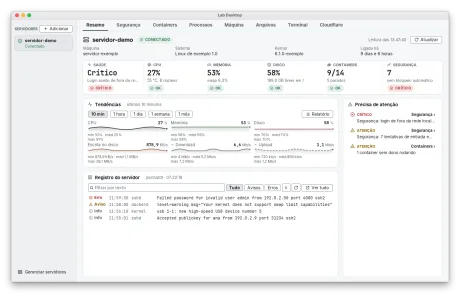</a> <a href="img/resumo-escuro.png">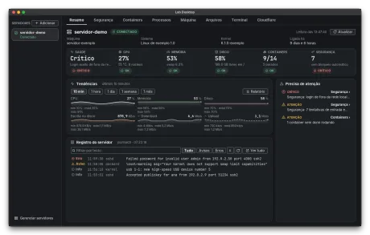</a> Resumo: saúde, seis gráficos de tendência, registro do servidor e o que pede atenção.</td>
    <td align="center" valign="top"><a href="img/relatorio-claro.png">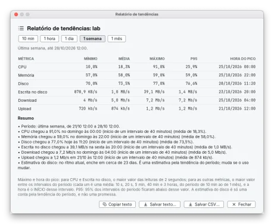</a> <a href="img/relatorio-escuro.png">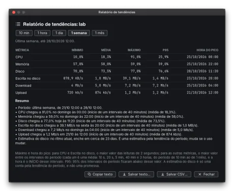</a> Relatório de tendências da última semana: mínimo, média, máximo, P95 e hora do pico.</td>
  </tr>
  <tr>
    <td align="center" valign="top"><a href="img/servidor-containers-claro.png">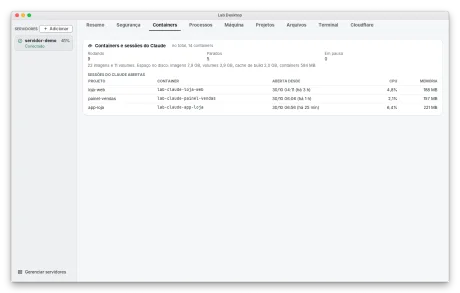</a> <a href="img/servidor-containers-escuro.png">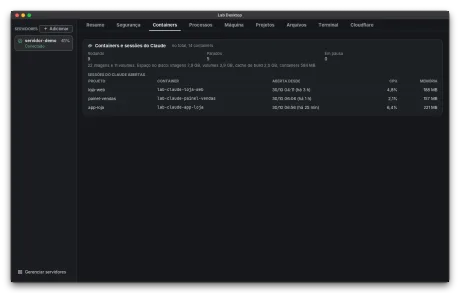</a> Containers: quantos rodam e as sessões do Claude abertas (se o servidor tem Claude).</td>
    <td align="center" valign="top"><a href="img/servidor-seguranca-claro.png">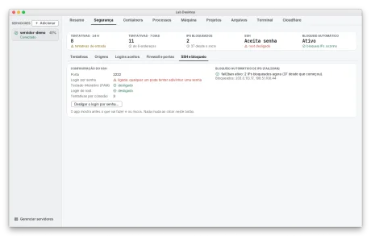</a> <a href="img/servidor-seguranca-escuro.png">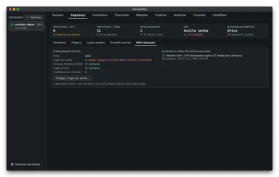</a> Segurança: SSH e bloqueio, com o login por senha ligado e o botão para desligá-lo.</td>
  </tr>
  <tr>
    <td align="center" valign="top"><a href="img/servidor-maquina-claro.png">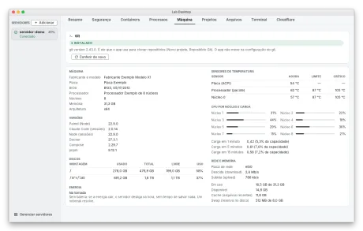</a> <a href="img/servidor-maquina-escuro.png">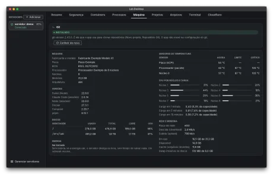</a> Máquina: versões, discos, temperatura, CPU por núcleo, rede, memória e o bloco do Git, que diz se ele está instalado.</td>
    <td align="center" valign="top"><a href="img/processos-claro.png">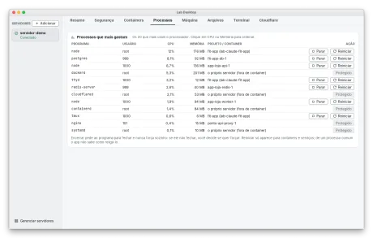</a> <a href="img/processos-escuro.png">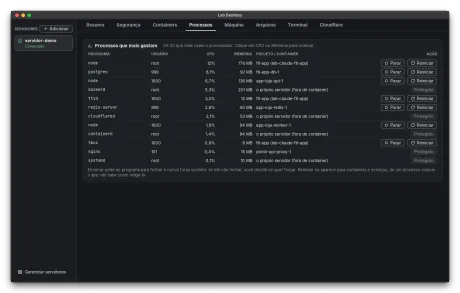</a> Processos: os que mais gastam, com Parar e Reiniciar para containers e Protegido para o resto.</td>
  </tr>
  <tr>
    <td align="center" valign="top"><a href="img/servidor-projetos-claro.png">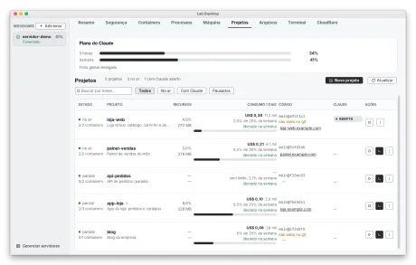</a> <a href="img/servidor-projetos-escuro.png">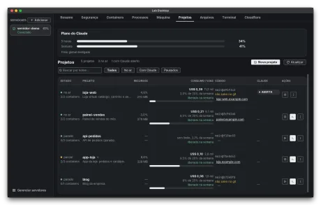</a> Projetos: a lista com consumo, código, endereço e o botão Novo projeto.</td>
    <td align="center" valign="top"><a href="img/servidor-arquivos-claro.png">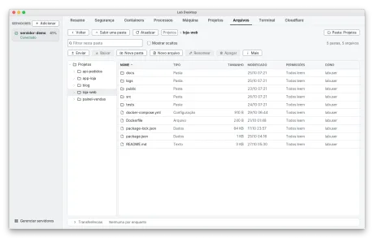</a> <a href="img/servidor-arquivos-escuro.png">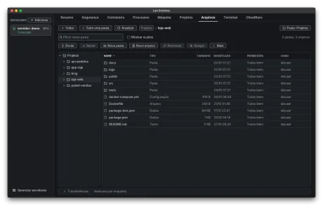</a> Arquivos: o gerenciador por SFTP, com árvore de pastas, Enviar e Baixar.</td>
  </tr>
  <tr>
    <td align="center" valign="top"><a href="img/servidor-terminal-claro.png">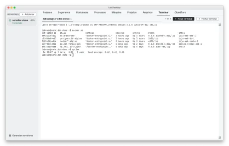</a> <a href="img/servidor-terminal-escuro.png">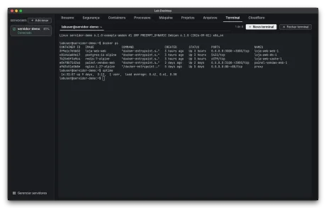</a> Terminal: um terminal de verdade no servidor, com várias abas.</td>
    <td></td>
  </tr>
</table>

## Projetos

A página de cada projeto.

<table>
  <tr>
    <td align="center" valign="top"><a href="img/projeto-visao-geral-claro.png">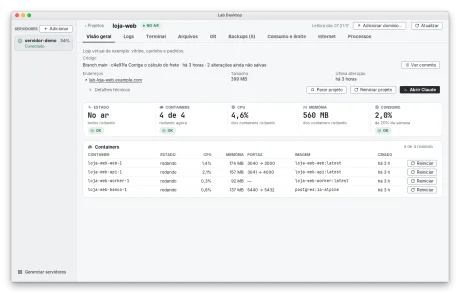</a> <a href="img/projeto-visao-geral-escuro.png">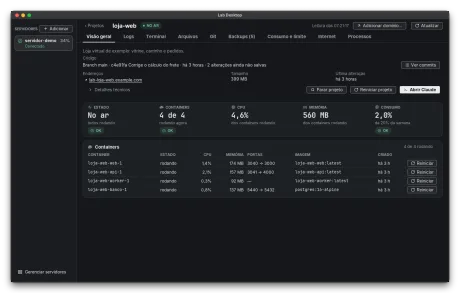</a> Visão geral: a linha Código (branch, último commit, alterações), endereços, containers e o consumo.</td>
    <td align="center" valign="top"><a href="img/projeto-logs-claro.png">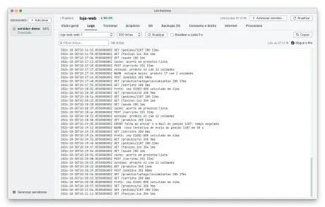</a> <a href="img/projeto-logs-escuro.png">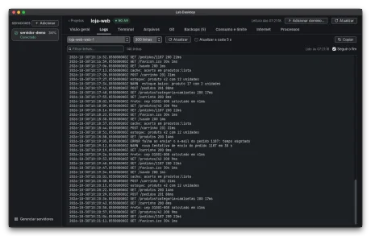</a> Logs: as linhas de um container, com filtro e atualização a cada 5 segundos se você quiser.</td>
  </tr>
  <tr>
    <td align="center" valign="top"><a href="img/projeto-terminal-claro.png">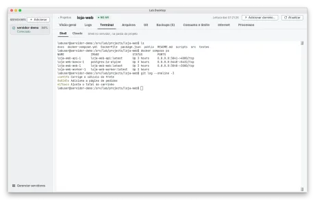</a> <a href="img/projeto-terminal-escuro.png">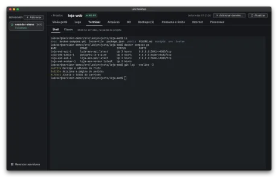</a> Terminal: um shell já na pasta do projeto.</td>
    <td align="center" valign="top"><a href="img/projeto-arquivos-claro.png">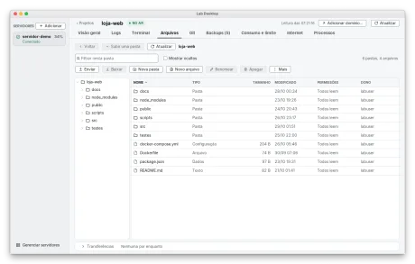</a> <a href="img/projeto-arquivos-escuro.png">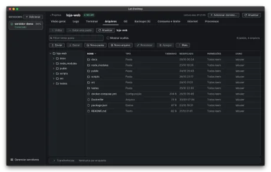</a> Arquivos: só a pasta do projeto.</td>
  </tr>
  <tr>
    <td align="center" valign="top"><a href="img/projeto-processos-claro.png">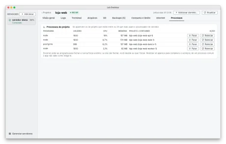</a> <a href="img/projeto-processos-escuro.png">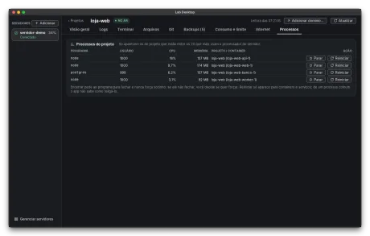</a> Processos do projeto: Parar e Reiniciar cada container.</td>
    <td align="center" valign="top"><a href="img/projeto-backups-claro.png">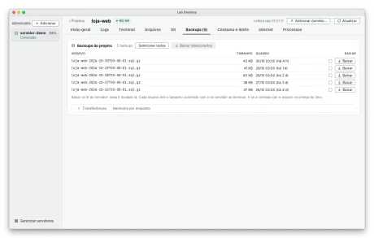</a> <a href="img/projeto-backups-escuro.png">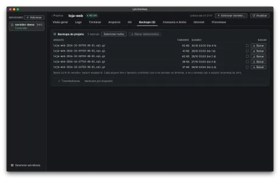</a> Backups: a lista dos arquivos de backup e Baixar, um a um ou vários.</td>
  </tr>
  <tr>
    <td align="center" valign="top"><a href="img/projeto-internet-claro.png">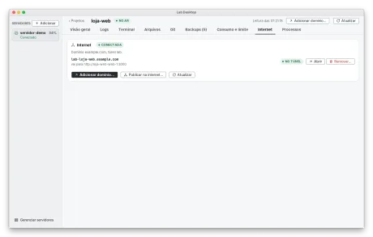</a> <a href="img/projeto-internet-escuro.png">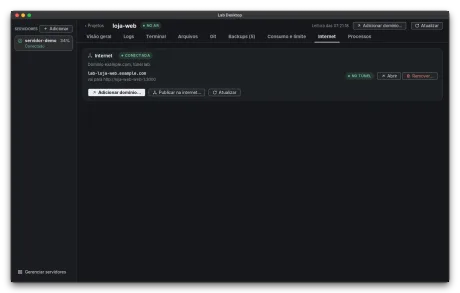</a> Internet: os endereços do projeto, Adicionar domínio e Publicar na internet.</td>
    <td></td>
  </tr>
</table>

## Git do projeto

Ler os commits, achar o repositório e criar um repositório novo. O app não faz push, não liga a remoto e não aprova nem mescla nada.

<table>
  <tr>
    <td align="center" valign="top"><a href="img/projeto-git-commits-claro.png">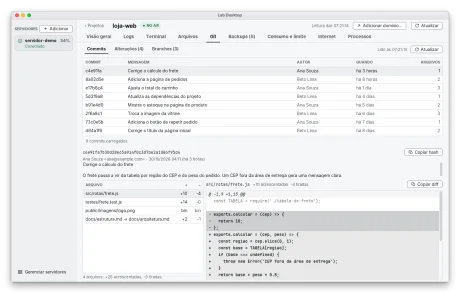</a> <a href="img/projeto-git-commits-escuro.png">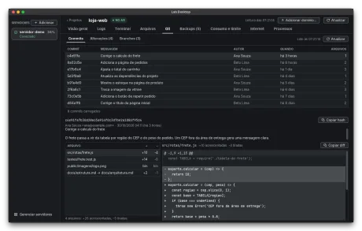</a> Aba Git, Commits: a lista, o commit escolhido, os arquivos que ele mudou e o diff com + e -.</td>
    <td align="center" valign="top"><a href="img/projeto-git-alteracoes-claro.png">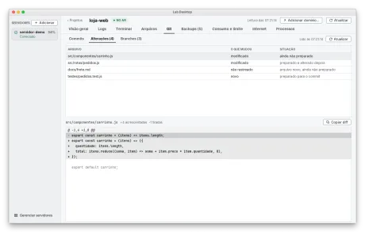</a> <a href="img/projeto-git-alteracoes-escuro.png">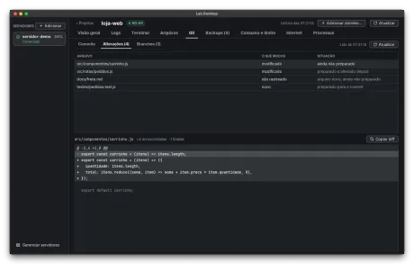</a> Alterações: o que ainda não foi commitado, com o diff de cada arquivo.</td>
  </tr>
  <tr>
    <td align="center" valign="top"><a href="img/projeto-git-branches-claro.png">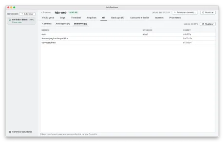</a> <a href="img/projeto-git-branches-escuro.png">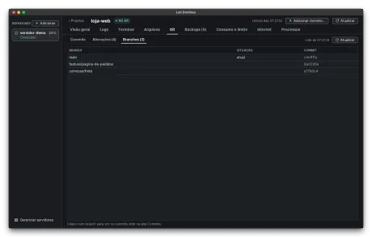</a> Branches: os branches do repositório, com o atual marcado.</td>
    <td align="center" valign="top"><a href="img/projeto-git-subpasta-claro.png">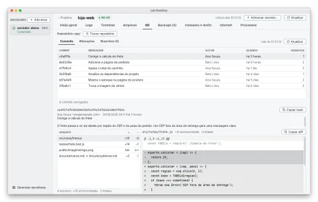</a> <a href="img/projeto-git-subpasta-escuro.png">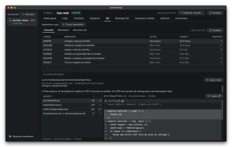</a> Repositório em subpasta: o app lê o app/ e mostra Trocar repositório.</td>
  </tr>
  <tr>
    <td align="center" valign="top"><a href="img/projeto-git-escolher-claro.png">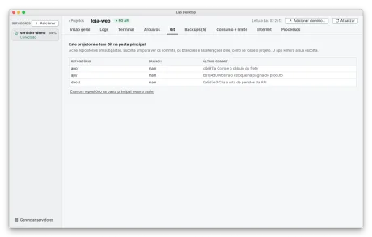</a> <a href="img/projeto-git-escolher-escuro.png">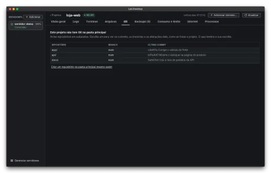</a> Vários repositórios em subpastas: você escolhe um, e o app lembra a escolha.</td>
    <td align="center" valign="top"><a href="img/projeto-git-segredo-claro.png">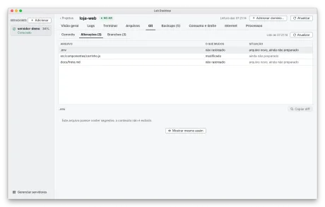</a> <a href="img/projeto-git-segredo-escuro.png">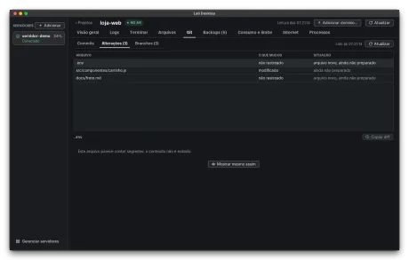</a> Arquivo com cara de segredo (.env): o conteúdo não aparece até você clicar em Mostrar mesmo assim.</td>
  </tr>
  <tr>
    <td align="center" valign="top"><a href="img/projeto-git-sem-git-claro.png">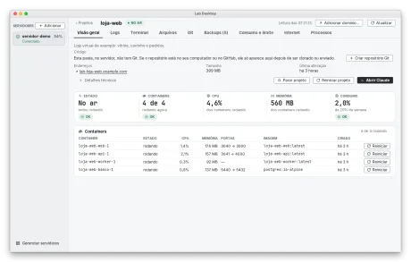</a> <a href="img/projeto-git-sem-git-escuro.png">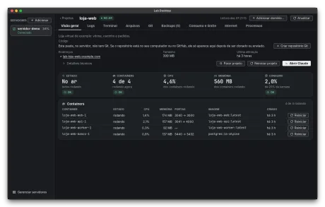</a> Pasta sem Git: a linha Código diz isso e oferece Criar repositório Git.</td>
    <td align="center" valign="top"><a href="img/projeto-git-nao-instalado-claro.png">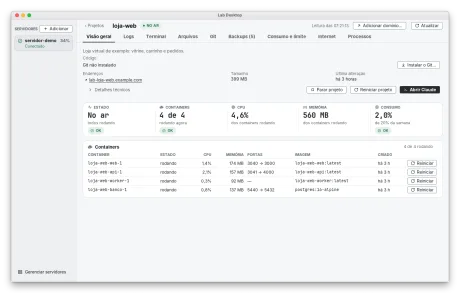</a> <a href="img/projeto-git-nao-instalado-escuro.png">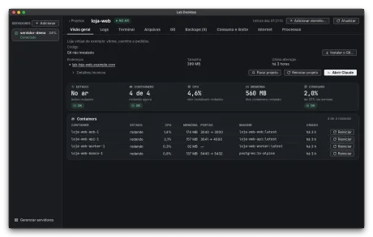</a> Git não instalado no servidor: a linha Código oferece Instalar o Git.</td>
  </tr>
  <tr>
    <td align="center" valign="top"><a href="img/projeto-git-outro-usuario-claro.png">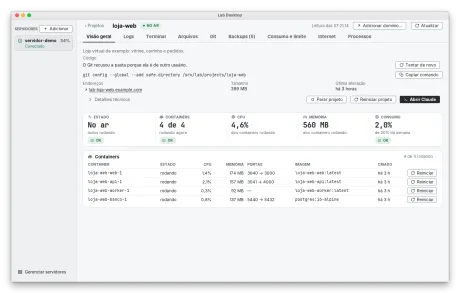</a> <a href="img/projeto-git-outro-usuario-escuro.png">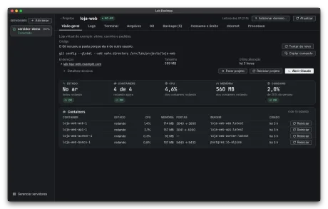</a> Pasta de outro usuário: o Git recusa e o app mostra o comando para você copiar (ele nunca o executa).</td>
    <td align="center" valign="top">  Criar repositório Git: a conferência só de leitura, com o que entra, o que fica de fora e os arquivos grandes.</td>
  </tr>
  <tr>
    <td align="center" valign="top">  Criar repositório numa pasta que já tem .gitignore: o app completa com as regras de segredos (.env, chaves) e mostra as linhas.</td>
    <td align="center" valign="top">  Criar repositório quando o Git não sabe quem você é: nome e e-mail gravados só neste repositório.</td>
  </tr>
  <tr>
    <td align="center" valign="top">  Já existe repositório numa subpasta: criar na pasta principal exige marcar uma caixa de confirmação.</td>
    <td align="center" valign="top">  Instalar o Git: os comandos exatos aparecem antes, e você pode só copiá-los.</td>
  </tr>
</table>

## Encerrar e reiniciar processos

Sempre com uma confirmação, e o app nunca força sozinho.

<table>
  <tr>
    <td align="center" valign="top">  Confirmação de Encerrar: nome, número, usuário, projeto ou container e hora de início; pede ao programa para fechar (SIGTERM).</td>
    <td></td>
  </tr>
</table>

## Cloudflare

Endereços na internet para os projetos, pela sua conta da Cloudflare.

<table>
  <tr>
    <td align="center" valign="top">  Aba Cloudflare: conta conectada, domínio, túnel e os endereços que o app criou.</td>
    <td align="center" valign="top">  Conectar a Cloudflare: o token fica escondido e só no cofre; a janela lista as permissões mínimas.</td>
  </tr>
  <tr>
    <td align="center" valign="top">  Escolher o domínio e o túnel (aqui gerido por arquivo no servidor) e conferir.</td>
    <td align="center" valign="top">  Adicionar domínio, passo 1 de 5: a conta.</td>
  </tr>
  <tr>
    <td align="center" valign="top">  Adicionar domínio, passo 3: o nome do endereço.</td>
    <td align="center" valign="top">  Adicionar domínio, passo 4: qual serviço e porta vão para a internet.</td>
  </tr>
  <tr>
    <td align="center" valign="top">  Publicar na internet: a prévia de tudo o que muda (compose, túnel e DNS) antes do clique.</td>
    <td></td>
  </tr>
</table>

## Conectar a um servidor

Direto por SSH, pelo AWS Session Manager ou pelo túnel da Cloudflare, sem abrir a porta do SSH.

<table>
  <tr>
    <td align="center" valign="top">  Lista de servidores: conectado direto, com o selo Sem porta aberta (SSM) e Protegido.</td>
    <td align="center" valign="top">  Adicionar servidor, passo 1: nome, usuário, Como conectar (Direto), endereço e Servidor protegido.</td>
  </tr>
  <tr>
    <td align="center" valign="top">  Como conectar, Direto (SSH), o padrão: só o endereço e a porta; nada de túnel.</td>
    <td align="center" valign="top">  Como conectar pelo AWS Session Manager: instância, região, perfil e porta.</td>
  </tr>
  <tr>
    <td align="center" valign="top">  Conferir as ferramentas neste computador: o aws foi achado, o plugin falta e o passo de instalar aparece como texto.</td>
    <td align="center" valign="top">  Editar um servidor que usa o Session Manager.</td>
  </tr>
  <tr>
    <td align="center" valign="top">  Como conectar pelo túnel da Cloudflare: o endereço do túnel.</td>
    <td align="center" valign="top">  Conferir as ferramentas: o cloudflared foi achado neste computador.</td>
  </tr>
  <tr>
    <td align="center" valign="top">  Editar um servidor que usa a Cloudflare.</td>
    <td align="center" valign="top">  O selo Sem porta aberta no cartão de cada servidor.</td>
  </tr>
  <tr>
    <td align="center" valign="top">  Confiar no servidor: a impressão digital e o comando para conferi-la no próprio servidor.</td>
    <td align="center" valign="top">  Primeira conexão: a senha vale uma vez, fica escondida e não é guardada.</td>
  </tr>
  <tr>
    <td align="center" valign="top">  No fim, o app pergunta se você quer desligar o login por senha (o padrão é manter).</td>
    <td align="center" valign="top">  Consertar Chave recusada: instalar a chave com a senha, só se o servidor for o que você confirmou.</td>
  </tr>
  <tr>
    <td align="center" valign="top">  Desligar o login por senha: o que será feito, os riscos, o comando para reverter e o nome do servidor para confirmar.</td>
    <td align="center" valign="top">  Editar servidor: nome, endereço, modo de conexão e acesso.</td>
  </tr>
  <tr>
    <td align="center" valign="top">  Editar servidor com a caixa Servidor protegido marcada.</td>
    <td align="center" valign="top">  Remover servidor: tira da lista e, se você quiser, apaga a chave e revoga o acesso.</td>
  </tr>
  <tr>
    <td align="center" valign="top">  O selo Protegido no cartão: o app só lê e conecta nesse servidor.</td>
    <td align="center" valign="top">  Servidor que não volta: depois de 12 falhas seguidas, tentativas a cada 5 minutos, com desde quando e a causa.</td>
  </tr>
  <tr>
    <td align="center" valign="top">  A mesma faixa quando o login da AWS expirou: o app mostra o comando para você copiar e rodar.</td>
    <td></td>
  </tr>
</table>

## Agente e este computador

O agente de monitoramento vai dentro do app, só lê a máquina (token obrigatório, sem inteligência artificial) e só é instalado depois da sua confirmação.

<table>
  <tr>
    <td align="center" valign="top">  O que instalar neste servidor: completo, escolher os itens ou só SSH.</td>
    <td align="center" valign="top">  Confirmação de instalar o agente: tudo o que foi conferido, os passos, o que o agente recebe e os avisos de segurança.</td>
  </tr>
  <tr>
    <td align="center" valign="top">  Confirmação de atualizar o agente: a versão instalada e a do app, o que o agente recebe e o aviso de que os gráficos do agente anterior recomeçam vazios.</td>
    <td align="center" valign="top">  Servidor com só o agente de monitoramento: sem aba Projetos e sem Claude, e o Resumo com os seis gráficos de 10 minutos.</td>
  </tr>
  <tr>
    <td align="center" valign="top">  O mesmo Resumo com os gráficos da última hora (o agente guarda até 30 dias).</td>
    <td align="center" valign="top">  Máquina lida pelo agente: sensores, CPU por núcleo, discos, rede e memória.</td>
  </tr>
  <tr>
    <td align="center" valign="top">  Containers: o agente conta o que roda no Docker e o espaço que ocupa, sem sessões do Claude.</td>
    <td align="center" valign="top">  Este computador: o laboratório rodando no Docker local, sem servidor e sem SSH.</td>
  </tr>
  <tr>
    <td align="center" valign="top">  Preparar este computador: o app só confere o que falta e mostra o que vai fazer antes de criar o laboratório.</td>
    <td></td>
  </tr>
</table>

## Novo projeto

Criar do zero, importar ou adicionar um container.

<table>
  <tr>
    <td align="center" valign="top">  Novo projeto: criar do zero, importar ou adicionar um container.</td>
    <td align="center" valign="top">  Criar do zero: o nome, onde a pasta fica e o que vem pronto.</td>
  </tr>
  <tr>
    <td align="center" valign="top">  Importar por Git: o endereço do repositório e o que vai acontecer.</td>
    <td align="center" valign="top">  Importar uma pasta do seu computador: sem node_modules, sem .git e sem arquivos de segredo, a menos que você marque.</td>
  </tr>
  <tr>
    <td align="center" valign="top">  Adicionar container (Redis): a diferença no docker-compose.yml aparece antes de gravar.</td>
    <td></td>
  </tr>
</table>

## Ajustes, Sobre e Ajuda

Tema, abas, informações do app e a Ajuda que vem dentro dele.

<table>
  <tr>
    <td align="center" valign="top">  Tema claro, escuro ou o do sistema, e o tamanho do texto.</td>
    <td align="center" valign="top">  Ordem e visibilidade das abas do servidor e do projeto.</td>
  </tr>
  <tr>
    <td align="center" valign="top">  Ajustes, Terminal: as preferências do terminal e, em "Ao sair de um projeto", a caixa que volta a perguntar.</td>
    <td align="center" valign="top">  Sair de um projeto com terminal aberto: o app pergunta, e a caixa "Não perguntar de novo" vem desmarcada.</td>
  </tr>
  <tr>
    <td align="center" valign="top">  A mesma pergunta com a caixa marcada: só vale se você confirmar a saída (Cancelar ignora a marca).</td>
    <td align="center" valign="top">  Sobre: versão, commit e data da compilação, o agente que o app leva, Java, sistema, pasta de dados, licença MIT e licenças de terceiros.</td>
  </tr>
  <tr>
    <td align="center" valign="top">  Ajuda no app: como conectar a um servidor.</td>
    <td align="center" valign="top">  Ajuda no app: Git do projeto.</td>
  </tr>
  <tr>
    <td align="center" valign="top">  Ajuda no app: o que fazer quando aparece Sem conexão.</td>
    <td></td>
  </tr>
</table>
